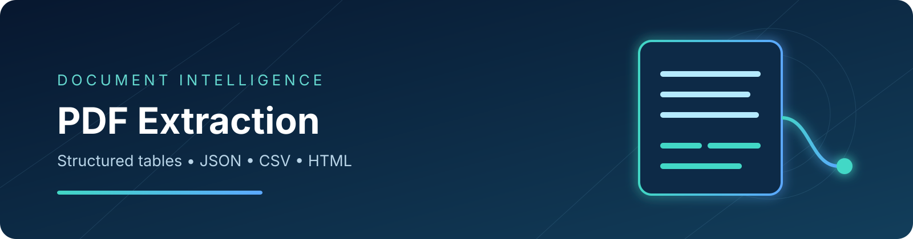
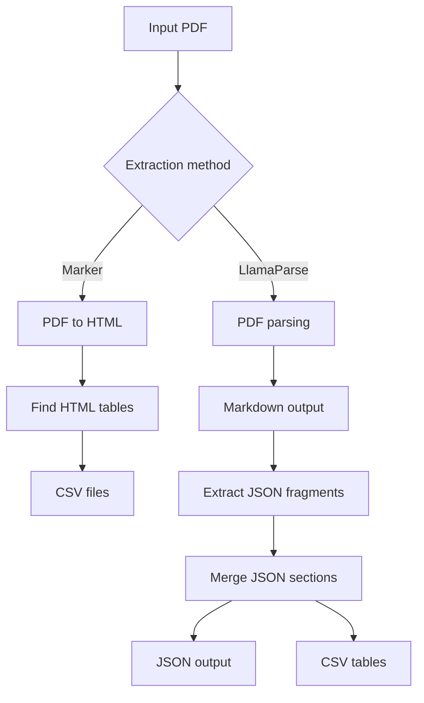

# PDF Document Extraction & Table Structuring



A Python-based document processing project for extracting structured content and tables from PDF files. It includes two complementary approaches:

- **Marker pipeline:** converts PDF documents to HTML and exports detected HTML tables as CSV files.
- **LlamaParse pipeline:** parses PDF content into Markdown, extracts JSON code blocks, combines the structured fragments, and exports detected tables to CSV.

The repository also preserves earlier implementations under `experiments/` and includes generic JSON schema examples.

## Features

- PDF-to-HTML conversion using Marker.
- HTML table detection and CSV export using Beautiful Soup and pandas.
- LlamaParse-based PDF parsing with configurable parsing instructions.
- JSON-fragment extraction and aggregation.
- JSON-to-CSV conversion for extracted table structures.
- Generic JSON schema examples for structured product attributes and pricing.
- Alternative/earlier extraction implementations retained separately for reference.

## Architecture



## Repository structure

```text
pdf-document-extraction/
├── assets/
│   └── project-banner.svg
├── examples/
│   └── schemas/
│       ├── schema.json
│       ├── base_feature_schema.json
│       ├── base_price_schema.json
│       ├── addon_feature_schema.json
│       ├── addon_price_schema.json
│       └── Series_schema.json
├── experiments/
│   ├── marker-v1/
│   └── llamaparse-json/
├── src/
│   └── pdf_document_extraction/
│       ├── marker_pipeline.py
│       ├── llamaparse_pipeline.py
│       └── __main__.py
├── .env.example
├── .gitignore
└── requirements.txt
```

## Technology stack

| Component | Technology |
|---|---|
| PDF-to-HTML | Marker |
| PDF parsing | LlamaParse |
| HTML parsing | Beautiful Soup |
| Table processing | pandas |
| Structured output | JSON and CSV |
| Language | Python |

## Setup

### 1. Clone the repository

```bash
git clone https://github.com/<your-username>/pdf-document-extraction.git
cd pdf-document-extraction
```

### 2. Create a virtual environment

```bash
python -m venv .venv

# Windows PowerShell
.venv\Scripts\Activate.ps1

# macOS / Linux
source .venv/bin/activate
```

### 3. Install dependencies

```bash
python -m pip install --upgrade pip
pip install -r requirements.txt
```

Marker may require additional system-level dependencies depending on your operating system and the selected model/device configuration. Follow the Marker installation instructions for your environment.

## Usage

### Option A: Marker PDF-to-HTML and CSV workflow

The command-line entry point uses the Marker implementation:

```bash
python -m pdf_document_extraction input.pdf --output-dir outputs/marker
```

The module is under `src/`, so either install the package in editable mode (after adding packaging metadata) or set the source path:

```bash
# Windows PowerShell
$env:PYTHONPATH = "src"

# macOS / Linux
export PYTHONPATH=src

python -m pdf_document_extraction input.pdf --output-dir outputs/marker
```

The pipeline:
1. Calls `marker_single` to convert the PDF to HTML.
2. Locates the generated HTML file.
3. Parses the HTML and finds table elements.
4. Converts each table to a CSV file.

### Option B: LlamaParse JSON workflow

Set the API key in your environment:

```bash
# Windows PowerShell
$env:LLAMA_CLOUD_API_KEY = "your_llama_cloud_api_key"

# macOS / Linux
export LLAMA_CLOUD_API_KEY="your_llama_cloud_api_key"
```

Then call the library functions:

```python
from pdf_document_extraction.llamaparse_pipeline import (
    initialize_parser,
    extract_markdown_text,
    extract_json_fragments,
    combine_fragments_to_json,
    save_json_to_file,
    json_to_csv,
)

parser = initialize_parser(result_type="markdown")
markdown = extract_markdown_text(parser, ["input.pdf"])
fragments = extract_json_fragments(markdown)
data = combine_fragments_to_json(fragments)

save_json_to_file(data, "outputs/extracted.json")
json_to_csv(data, "outputs/csv_tables")
```

Make sure `PYTHONPATH=src` is set before running the example.

## Experiments

The `experiments/` directory contains earlier Marker and LlamaParse scripts. They are retained for comparison and historical context; the primary entry points are the modules under `src/pdf_document_extraction/`.

## Example schemas

The `examples/schemas/` directory contains genericized schema structures illustrating how extracted attributes and price tables can be represented as structured JSON. These are schema examples, not extracted customer documents or production datasets.

## Data, privacy, and security

- Source PDFs, extracted HTML, generated CSV/JSON outputs, and page images from the original archive are intentionally excluded.
- Use documents that you own or are authorized to process.
- Keep API keys in environment variables; never commit `.env` files or credentials.
- Review extracted text and tables for sensitive or personal information before sharing outputs.

## Limitations

- Table quality depends on the source PDF layout and the selected extraction engine.
- Marker and LlamaParse may produce different table structures.
- The supplied code snapshot was reorganized and credential handling was improved, but end-to-end execution was not validated against a live PDF or external API during packaging.
- The LlamaParse JSON-to-CSV utility expects JSON fragments fenced as `json` code blocks in the Markdown response; other output formats may require additional parsing logic.

## License

Open-Source
